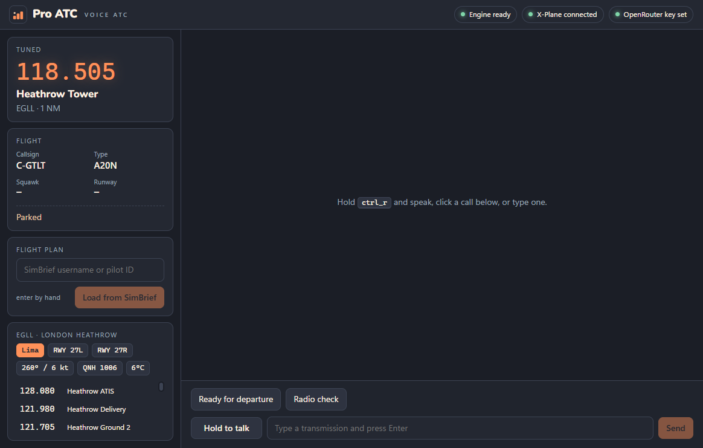

# Pro ATC: free AI voice ATC for X-Plane 12

Talk to air traffic control in X-Plane 12 with your own voice. Pro ATC is a free, open-source app that plays every controller, from clearance to landing, IFR or VFR, at any airport in the sim.

## Download

| Your system | Download | First start |
|---|---|---|
| **Windows** 10 or 11 | [ProATC-windows-x64-setup.exe](https://github.com/gustavorubim/proatc/releases/latest/download/ProATC-windows-x64-setup.exe) | "More info", then "Run anyway" |
| **macOS** 12 or newer, Apple Silicon (M1 or newer) | [ProATC-mac-arm64.dmg](https://github.com/gustavorubim/proatc/releases/latest/download/ProATC-mac-arm64.dmg) | System Settings > Privacy & Security > "Open Anyway" |
| **Linux** x64 | [ProATC-linux-x86_64.AppImage](https://github.com/gustavorubim/proatc/releases/latest/download/ProATC-linux-x86_64.AppImage) | `sudo apt install libportaudio2`, then `chmod +x` and run |

These links always give the newest version. [All releases](https://github.com/gustavorubim/proatc/releases) · [Installing on each system](docs/install.md)

## What you get

- **Real ATC, not a script.** Controllers use the sim's real frequencies, taxiways, SIDs, STARs, approaches and airspace. Nothing is made up.
- **Airport map.** Your taxi route is highlighted on a map of the airport, with the runway to hold short of.
- **Speak, click or type.** Every call you can make is also a button, so you never get stuck.
- **Help when you need it.** "What do I say?" gives you the next call, "Phraseology" turns what you type in your own words into the proper call, and a copilot can do the radio for you.
- **Free.** Voices and speech recognition run on your computer. Understanding what you said uses your own [OpenRouter](https://openrouter.ai) key (about a cent per flight) or a free local model.

## Get started

1. Download the file for your system from the table above and install it. The app is not signed, so the system warns the first time ([what to do](docs/install.md)).
2. Open Pro ATC and wait for the first-time setup (a few minutes, about 3 GB).
3. Click "Add OpenRouter key" and paste a key from [openrouter.ai/keys](https://openrouter.ai/keys).
4. Start X-Plane 12, load a flight, click a frequency in the app and hold right Ctrl to talk.

Needs X-Plane 12.1.1 or newer. Works with SimBrief and Navigraph. No plugin to install.

Windows is the system Pro ATC is developed and flown on. The Mac and Linux versions are new: they are built and started by automated tests, and not yet flown. If you try one, [tell us how it went](https://github.com/gustavorubim/proatc/issues/new/choose). Intel Macs are not supported yet.

## Good to know

- Other aircraft are heard and seen, but not controlled.
- There is no window inside the sim yet, so it is awkward in VR.
- English only.

## Help and details

- Something wrong? Click **Save log** in the app and [open an issue](https://github.com/gustavorubim/proatc/issues/new/choose) with the two files.
- [Installing on each system](docs/install.md): the first-run warnings, and what macOS and Linux need.
- [How it works](docs/how-it-works.md): everything the controllers do.
- [Development](docs/development.md): build from source, releases.
- [Verifying a change](docs/testing.md): tests, golden flights, log replay, benchmarks.

Licence: [MIT](LICENSE). Not affiliated with Laminar Research, Navigraph, SimBrief or OpenRouter. For flight simulation only.
